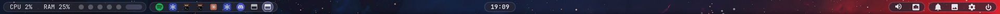
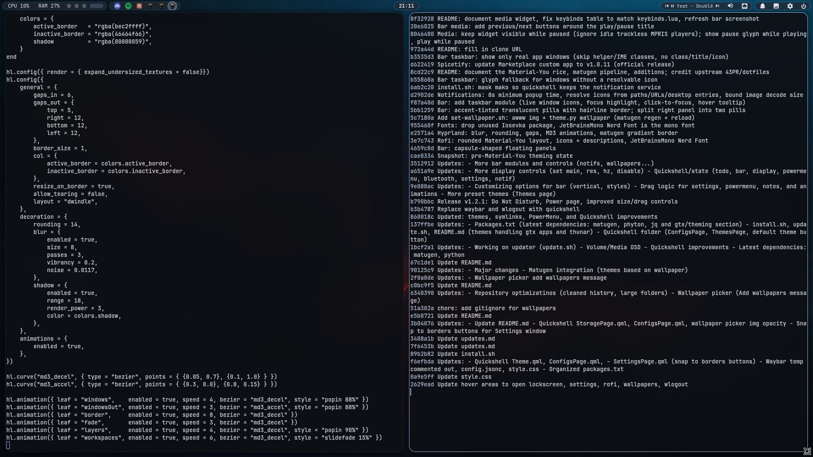
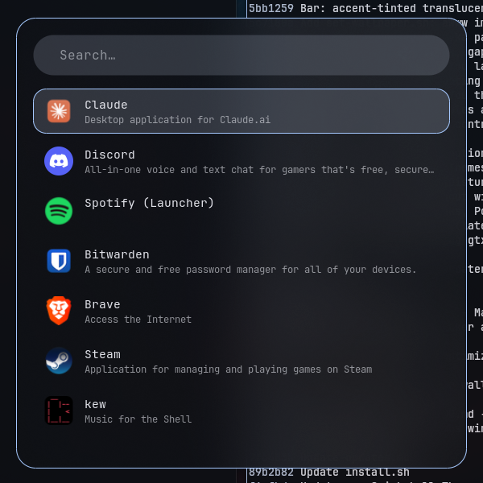

<div align="center">

## Hyprland · Material-You Rice

A polished, wallpaper-driven **Material-You** Hyprland desktop: capsule-pill Quickshell bar, a clean Rofi launcher, matugen colors everywhere, blur and smooth animations.


**[Screenshots](#screenshots)  -  [What's new](#whats-new-in-this-fork)  -  [Matugen pipeline](#how-the-matugen-pipeline-works)  -  [Keybinds](#keybinds)  -  [Installation](#installation)  -  [Credits](#credits--license)**

</div>

> **This is a fork of [43PR/dotfiles](https://github.com/43PR/dotfiles)** (MIT). The base setup, Quickshell shell, settings app, theme engine, keybinds and installer are 43PR's work. This fork adds a visual layer on top, listed under [What's new](#whats-new-in-this-fork). Beyond that visual layer, the fork made two keybind-related changes (the `Super + R` recorder fix and the `Super + /` cheat sheet) and set up a per-monitor workspace layout in `monitors.lua`; window rules are untouched. A few settings already differed from upstream before the fork; both lists are under [Keybinds](#keybinds). See [Credits](#credits--license).

## Screenshots

**Capsule bar** — workspaces + stats, taskbar, clock, and the two right-hand pills:



**Windows** — rounded corners, 1px matugen gradient border, gaps, shadow, blur:



**Rofi** — rounded launcher with icons, descriptions and one highlighted row, blurred over the windows behind it:



All colors above were generated from the wallpaper. Change the wallpaper and everything re-themes.

## What's new in this fork

### Visuals

- **Capsule pills** — the floating bar's panels are true capsules (`radius = min(width, height) / 2`) with an accent-tinted, semi-transparent background and a 1px accent hairline border. The existing bar-opacity slider still scales them. The `joined` and `strip` bar styles are unchanged.
- **Right-pill split** — the right side of a horizontal bar is two pills instead of one: *media · volume · battery · net* and *notifications · wallpapers · settings · power*. It splits by module id, so the drag-to-reorder settings still work. Vertical bars keep a single panel.
- **Taskbar module** — a new bar module (`Taskbar` in the bar settings, on by default) in its own pill next to the workspaces:
  - one icon per open application window, live from quickshell's `Hyprland.toplevels`, using each app's real icon from its desktop entry;
  - helper and utility surfaces (Steam's `steamwebhelper`, input-method/IME popups) and windows with no class, title or resolvable icon are skipped;
  - the focused window is highlighted;
  - click focuses the window and jumps to its workspace;
  - hover shows `<app name> · workspace <n>`.
- **Media widget** — the now-playing module in the right pill:
  - stays visible while paused, so you can resume from it. Before, an idle player with no track (a Chromium-based app reporting `Stopped`) could be picked when nothing was playing and hide the widget; now it sticks to the player that last played, then any player with a track, and hides only when no player has one;
  - the glyph shows ⏸ while playing and ▶ while paused; click the title to toggle play/pause;
  - new ⏮ previous / ⏭ next buttons on either side call MPRIS `previous()` / `next()` on the active player (dimmed when the player can't skip). Right-click and middle-click on the title still skip forward and back.
- **Rofi theme** — rounded 24px window, capsule search bar, 36px icons, app descriptions under each name, a single highlighted row, JetBrainsMono Nerd Font. It reads the generated `colors.rasi`, so it follows the wallpaper.
- **Hyprland look** (`.config/hypr/look.lua`) — 1px gradient border from the matugen accent, rounding 14, gaps 6 in / 12 out, blur (size 8, 3 passes, noise), soft shadow, and Material-3 style animations (`md3_decel` / `md3_accel` curves, popin windows, layer animations for rofi and bar popups).

### Tools and fixes

- **`set-wallpaper.sh`** (`.config/43pr/bin/`) — `set-wallpaper.sh [image]` sets the wallpaper on all outputs with `awww`, then runs `theme.py wallpaper` to regenerate colors and reload everything. No argument picks a random image from `~/Pictures/Wallpapers`. It isn't bound to a key; bind it yourself if you want one.
- **Notification fix** — mako ships a D-Bus activation file, so a notification sent while quickshell was restarting would auto-start mako, which then kept `org.freedesktop.Notifications` and blocked quickshell's built-in server. `install.sh` now masks `mako.service`. Popups also stay at least 8 seconds (max 15), and icons resolve from theme names, absolute paths, `file://` URLs, image hints, or the app's desktop entry.
- **Multi-monitor panel fix** — the notifications panel, settings window, and bar sound/network buttons now open on the focused monitor instead of landing on a random one. Each panel calls `followFocusedMonitor()` before showing.
- **Fonts** — JetBrainsMono Nerd Font is the monospace font (bar, rofi, kitty). GTK apps stay on Adwaita Sans.
- **Screen recorder fix** — `Super + R` was hard-coded to record `HDMI-A-1`, so it failed on any machine without that output. It now asks Hyprland for the focused monitor each time it's pressed (falling back to `screen`). `gpu-screen-recorder` is now listed in `packages.txt`, since the keybind needs it.
- **Keybind cheat sheet** — `Super + /` opens `.config/hypr/keys.txt` in rofi: every keybind grouped by apps, windows, workspaces, look, screenshots/recording, input and session, plus a few terminal commands this setup provides.
- **Spicetify Marketplace** — updated the bundled Marketplace custom app to the official v1.0.11 release.

## How the matugen pipeline works

One script, `.config/43pr/bin/theme.py`, turns a wallpaper into colors for every app.

```
wallpaper ──► matugen image ──► semantic palette ──► render templates ──► write files ──► reload apps
              (config.toml +     (~/.cache/43pr/      (targets.toml)       (per target)    (reload hooks)
               semantic.json)     palette.json)
```

1. `theme.py wallpaper <image>` runs `matugen image` with `.config/matugen/config.toml`. Its template, `.config/matugen/templates/semantic.json`, maps Material-You roles (`primary`, `surface_container`, `outline_variant`, …) to this setup's semantic names (`accent`, `bg_panel`, `border`, …).
2. `.config/43pr/targets.toml` lists each output: an input template under `.config/43pr/templates/` and an output file. Templates use `{{name}}` tokens with filters such as `|alpha=70` or `|hex8=ff`.
3. Targets: kitty, rofi (`colors.rasi`), hyprlock, GTK 3/4, the quickshell theme JSON (bar, notifications, settings), and Hyprland (`hypr/matugen-colors.lua`, read by `look.lua` for the border and shadow, with a fixed fallback if missing).
4. All targets are rendered first and written only if every one succeeds, then reload hooks run (kitty reloads its colors; Hyprland runs `hyprctl reload config-only`).

Useful commands:

```bash
theme.py colorgen off           # stop wallpaper changes from re-theming (colors are ON by default)
theme.py colorgen on            # turn wallpaper-driven colors back on
theme.py wallpaper <image>      # regenerate from a wallpaper
theme.py preset nord            # use a preset theme instead (also: tokyo-night, dracula, ...)
theme.py status                 # current mode / preset / wallpaper
.config/43pr/bin/set-wallpaper.sh [image]   # set wallpaper + regenerate in one go
```

`theme.py` lives at `~/.config/43pr/bin/theme.py` after install. Generated files (`rofi/colors.rasi`, `hypr/matugen-colors.lua`, GTK/kitty/hyprlock colors) are gitignored.

## Keybinds

> **You can modify keybinds using HyprMod.** Press `Super + /` for a cheat sheet of everything below.
>
> **Changed by this fork:**
> - `Super + R` records the focused monitor instead of a hard-coded `HDMI-A-1` (needs `gpu-screen-recorder`);
> - added the `Super + /` cheat sheet, `.config/hypr/keys.txt` (the binding was already in this setup, but the file was never committed, so it opened an empty menu on a fresh clone).
>
> **Already differed from upstream 43PR before the fork:**
> - power menu on `Super + Escape` (upstream: `Super + Grave`);
> - light/dark toggle on `Super + Shift + T` (upstream: `Super + L`);
> - screenshots on `Super + Delete` and `Super + Shift + S` (upstream: `Delete` and `Shift + Delete`);
> - a custom `monitors.lua` for this machine's three monitors with a per-monitor workspace layout: center (ASUS) gets 1–3, left (LG) gets 4–5, right (AU Optronics) gets 6–7. Rules are resolved by monitor description so they survive port changes;
> - `rules.lua`: fullscreen windows use `opacity = "0.9 override"` (upstream: `1.0`).

| Keybind                 | Action                    |
| -----------             | ------------------------- |
| `Super + T`             | Terminal                  |
| `Super + Q`             | Close active window       |
| `Super + D`             | Application launcher      |
| `Super + Space`         | Toggle floating window    |
| `Super + F`             | Toggle fullscreen         |
| `Super + 1, 2, 3..`     | Change workspaces         |
| `Super + Shift + 1, 2..`| Move window to workspace  |
| `Super + E`             | File manager              |
| `Super + B`             | Browser                   |
| `Super + V`             | Clipboard history         |
| `Super + S`             | Second launcher           |
| `Super + I`             | Settings menu             |
| `Super + W`             | Wallpaper selector        |
| `Super + O`             | Switch opacity            |
| `Super + Tab`           | Lock screen               |
| `Super + Escape`        | Power/logout menu         |
| `Super + Shift + W`     | Toggle bar                |
| `Super + Mouse wheel`   | Zoom in/out               |
| `Super + C`             | Notes/To-do               |
| `Super + N`             | Notifications             |
| `Super + H / J / K / L` | Focus left/down/up/right  |
| `Super + Shift + H/J/K/L`| Move window              |
| `Super + Ctrl + H/J/K/L`| Resize window             |
| `Super + Shift + T`     | Light/dark theme toggle   |
| `Super + X`             | Next keyboard layout      |
| `Super + R`             | Start/stop screen recording (focused monitor) |
| `Super + /`             | Keybind cheat sheet       |
| `Super + Shift + E`     | Quit Hyprland (no confirm)|
| `Super + Delete`        | Screenshot fullscreen     |
| `Super + Shift + S`     | Screenshot area select    |

> **Move and resize windows with Super + left/right mouse drag.**
>
> All keybinds: [.config/hypr/keybinds.lua](.config/hypr/keybinds.lua)

---
## Installation

Works for Arch, CachyOS, EndeavourOS, Manjaro, etc. Mainly intended for a clean installation; existing configuration files that are replaced are backed up automatically.

```bash
sudo pacman -S git
git clone https://github.com/Soulsagate/hypr-material-you.git dotfiles
cd dotfiles
chmod +x install.sh
./install.sh
```

Then log out and back in. The installer also masks `mako.service` so quickshell owns notifications.

1. **Wallpapers** — the desktop starts empty. Put images in `~/Pictures/Wallpapers` and open the wallpaper picker with `Super + W`.
2. **Wallpaper colors** — on by default: pick a wallpaper and everything re-themes. To keep the current colors when you change wallpapers, run `theme.py colorgen off` (`colorgen on` re-enables it). Or use a preset with `theme.py preset <name>`.
3. **Hardware-specific config** — `.config/hypr/monitors.lua` is for a 3-monitor setup (two landscape, one rotated) and some GPU/driver bits are Nvidia-specific. Edit these for your machine before first login.

> [!important]
> **Do not move or delete the dotfiles repository after installation.** The setup uses symlinks into the cloned repo. If you relocate it, run `./install.sh` again and the links are updated.

> [!note]
> Quickshell does not live-reload these symlinked files. After editing a `.qml` file, restart it: `qs kill; qs` (or `./update.sh --restart-shell`). If `qs kill` leaves a stuck instance, `pkill qs` first.

### Updating

```bash
cd dotfiles
git pull
./update.sh
```

Options: `--dry-run`, `--skip-packages`, `--skip-theme`, `--restart-shell`.

All programs: [packages.txt](packages.txt)

---
## Credits & License

- **[43PR/dotfiles](https://github.com/43PR/dotfiles)** — upstream. The base Hyprland configuration, Quickshell shell (bar, settings, power menu, notes, notifications), `theme.py` theme engine, installer and updater are 43PR's. Wallpapers: <https://wallhaven.cc/user/43pr>.
- **[hyprquickpaper](https://github.com/iamsurjog/hyprquickpaper)** — the wallpaper picker, tweaked by upstream.
- **[Matugen](https://github.com/InioX/matugen)** — Material-You color generation.
- **Spicetify "text" theme** by darkthemer, modified by upstream.
- Visual direction inspired by the [dusky](https://github.com/dusklinux/dusky) dotfiles. Nothing was copied from it; the pills, rofi theme and templates here are written for this setup.

Released under the **MIT License** (see [LICENSE](LICENSE)), the same license as upstream; the original copyright notice is kept as required. Changes in this fork are released under the same terms.
